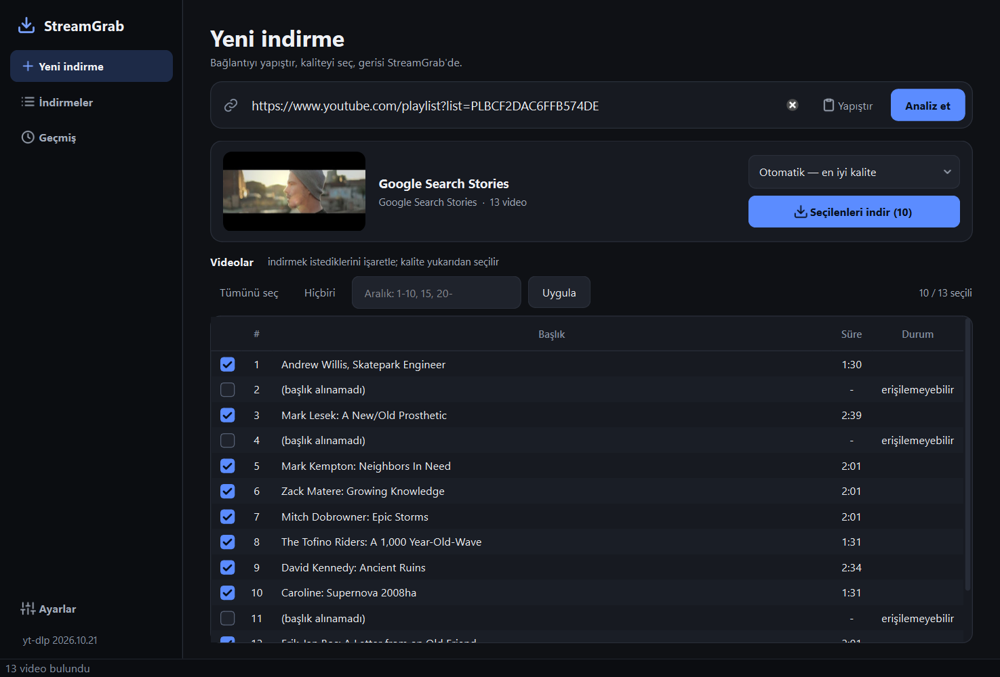

# StreamGrab

Windows için 64-bit, modern bir video indirici. **Media Downloader**'ın
(`%ProgramFiles(x86)%\Media Downloader`) mimarisinden ilham alır, ama 32-bit
mirasını taşımaz: Qt GUI + harici motor + bildirimsel motor tanımı.



## Neden bu mimari?

Video indirmenin zor kısmı arayüz değil, **gerçek medya adresini bulmak**.
Bunu kendin yazmak her site güncellemesinde kırılan bir extractor koleksiyonu
demek. Bu yüzden:

```
PySide6 arayüzü
      │  URL
      ▼
DownloadManager  ──►  yt-dlp (alt süreç)  ──►  ffmpeg (alt süreç)
      │                    │
      │  @@PROG@@ satırı    └─ --dump-single-json  (metadata)
      ▼
ilerleme / kuyruk / iptal
```

Motorlar `streamgrab/engines/*.json` içinde **veri** olarak tanımlı. Yeni bir
motor eklemek kod değil, JSON değişikliğidir.

## Media Downloader'dan alınan fikirler

| Media Downloader | StreamGrab |
|---|---|
| `engines.v1/*.json` bildirimsel motor şeması | `streamgrab/engines/yt-dlp.json` |
| `--print "{...formats...}"` ile JSON metadata | `--dump-single-json` |
| `--progress-template` + `[download] … ETA` satır kuralı | `@@PROG@@` işaretli satır |
| Motoru uygulamadan bağımsız güncelleme | `streamgrab/core/updater.py` |
| 32-bit, gömülü Python 3.8 | 64-bit, Python 3.13, `python -m yt_dlp` veya `bin/yt-dlp.exe` |
| QProcess + C++ | Python + `subprocess` + Qt sinyalleri |

## Kurulum

Kullanıcılar için `StreamGrab-Setup-<sürüm>.exe` yeterli: yönetici izni istemez,
Python gerektirmez. İlk açılışta eksik araçları tek tıkla indirir.

Geliştirme için:

```powershell
python -m venv .venv
.\.venv\Scripts\pip install -r requirements-dev.txt
.\run.bat          # konsollu (hataları görürsün)
.\run-silent.bat   # konsolsuz
.\.venv\Scripts\python -m pytest tests
```

## Araçlar

İlk açılış kurulumu (veya **Ayarlar → Araçlar**) resmi yayınlardan indirir ve
yayımlanan SHA-256 özetiyle doğrular:

| Araç | Görevi | Boyut |
|---|---|---|
| yt-dlp | Videoyu çözümler ve indirir | ~20 MB |
| ffmpeg | Ses ve görüntüyü birleştirir, MP3'e çevirir | ~200 MB |
| deno | YouTube'un JavaScript korumalarını çözer; yoksa formatlar eksik kalır | ~45 MB |

PATH'te bulunanlar yeniden indirilmez. deno yerine PATH'teki Node.js de kullanılır.
Araçlar geliştirme ortamında `bin\`, kurulu uygulamada
`%LOCALAPPDATA%\StreamGrab\bin` altındadır.

## Paketleme

```powershell
winget install JRSoftware.InnoSetup --scope user
.\packaging\build.ps1      # dist\StreamGrab-Setup-<sürüm>.exe
```

PyInstaller tek klasörlü paket üretir, Inno Setup bunu kurulum dosyasına çevirir.
yt-dlp/ffmpeg/deno pakete girmez, bu yüzden kurulum küçük kalır ve motor
uygulamadan bağımsız güncellenir. Kurulum dosyası imzasız olduğu için Windows
SmartScreen ilk çalıştırmada uyarı gösterebilir.

## Özellikler

- URL analizi (başlık, süre, yükleyici, küçük resim, tüm formatlar)
- Oynatma listesi ve kanal: videoları işaretle, aralık ver (`1-10, 15, 20-`), toplu indir
- Format tablosu: çözünürlük / codec / boyut; satır seçerek indirme
- Hazır seçenekler: otomatik, 1080p, 720p, ses (MP3)
- Eş zamanlı indirme kuyruğu (1–8), canlı ilerleme, hız, ETA
- Duraklat / devam et: yarım dosyadan sürer, uygulama kapansa bile
- Kalıcı kuyruk: yarım kalan işler sonraki açılışta devam eder
- Otomatik yeniden deneme (bağlantı hataları) ve Türkçe hata açıklamaları
- İndirme geçmişi ve arşiv: daha önce indirilenler işaretlenir, atlanır
- İptal (ffmpeg çocuk süreci dahil, `taskkill /T`)
- Tarayıcı çerezleri (`--cookies-from-browser`) — giriş gerektiren içerik
- Sürükle-bırak URL, panodan yapıştır, `Ctrl+V`
- Yan menülü karanlık tema, Türkçe arayüz
- `StreamGrab.exe <url>`: bağlantıyla açılıp doğrudan analiz eder

## Klasör yapısı

```
streamgrab/
  main.py                 giriş noktası
  config.py               JSON ayarlar (%APPDATA%\StreamGrab\settings.json)
  paths.py                yol çözümleme (bin/, engines/)
  engines/
    yt-dlp.json           motor sözleşmesi (argümanlar, ilerleme şablonu)
    loader.py             executable/module çözümleme + komut kurma
  core/
    runner.py             gizli subprocess, kill_tree, run_capture
    probe.py              metadata + format normalizasyonu
    downloader.py         kuyruk, worker thread'ler, ilerleme parse
    tools.py              ffmpeg / aria2 / JS ortamı keşfi
    updater.py            araç indirme ve SHA-256 doğrulama
    store.py              kuyruk, geçmiş, arşiv dosyaları
    errors.py             hata -> Türkçe mesaj + tekrar denenebilir mi
    playlist.py           aralık ayrıştırma, klasör adı
  ui/
    main_window.py        ana pencere
    chrome.py             ikonlar, kapak resmi, koyu başlık çubuğu
    playlist_panel.py     işaretlenebilir video listesi
    history_dialog.py     geçmiş penceresi
    setup_dialog.py       ilk açılış kurulumu
    widgets.py            iş satırı, elide edilen etiket
    settings_dialog.py    ayarlar + güncelleme
    theme.py              renk token'ları + QSS
  assets/                 uygulama simgesi, tema ikonları
bin/                      yt-dlp.exe / ffmpeg.exe / deno.exe (geliştirme)
packaging/                PyInstaller + Inno Setup
tests/                    pytest; sahte motorla kuyruk yaşam döngüsü
tools/screenshot.py       README görselini üretir
```

## Sonraki adımlar (yol haritası)

1. **Toplu indirme**: URL listesi içe aktarma (`-a urls.txt`)
2. **Altyazı ve bölüm** indirme seçenekleri
3. **Otomatik güncelleme kontrolü** açılışta (şu an elle)

## Yasal not

Bu araç yalnızca indirme yetkisine sahip olduğun içerik için kullanılmalıdır.
YouTube'un kullanım şartları indirmeyi yasaklar; DRM'li içerik (Netflix,
Disney+ vb.) kapsam dışıdır ve bu proje DRM'e dokunmaz.
